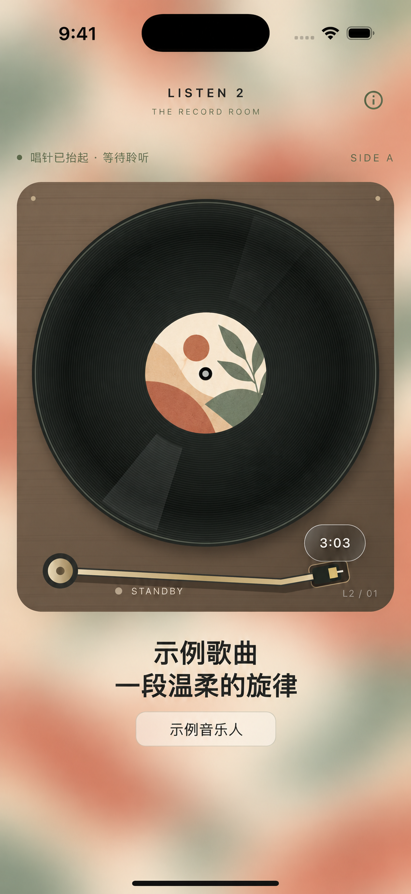
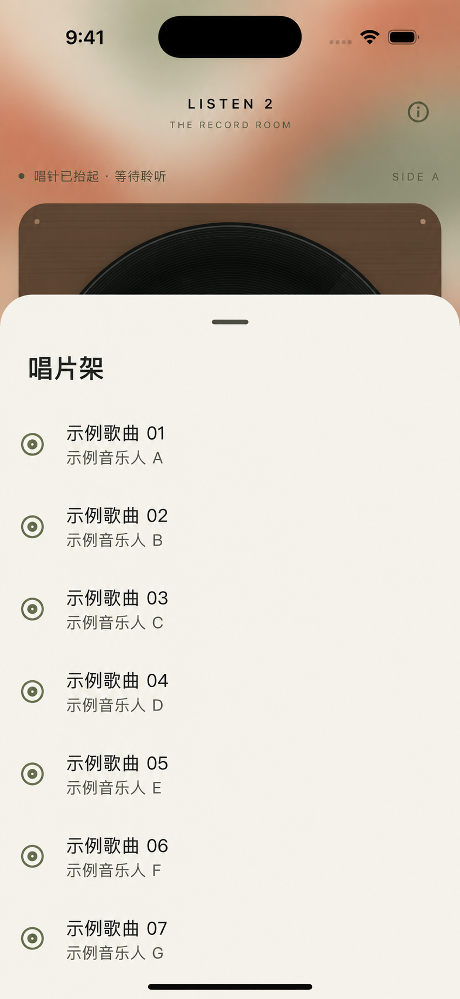

# Listen 2

把喜欢的音乐，放上你的唱片机。

Listen 2 是一款基于 Flutter 的音乐播放器，以黑胶唱片机为灵感，将音乐搜索、歌单收藏和播放操作融入唱片、唱臂与唱片架的交互中。音乐内容来自 Bilibili，项目包含 Android、iOS 和 Windows 平台工程。

## 使用声明与免责声明

**作者发布本项目的目的仅为学习、学术研究和技术交流。使用者应自行评估使用场景、取得必要授权，并依法承担自身行为产生的责任。**

- **第三方内容与授权**：音视频、封面、商标等第三方内容的权利归各自权利人所有。本项目的开源许可仅涵盖相应代码与项目文档，不授予对第三方内容的访问、下载、复制、使用或传播权利，也不代表相关平台或权利人的授权、认可或背书。
- **使用者责任**：使用者应遵守适用法律、平台规则及相关授权要求，不得利用本项目侵犯他人合法权益、绕过访问控制或实施其他违法行为。因使用者自行修改、部署、运营、传播或使用本项目而产生的争议、索赔及法律责任，由使用者依法承担；项目作者与贡献者不为使用者的行为提供担保或背书。
- **无担保提供**：本项目按“现状”和“可用状态”提供。作者、版权持有人与贡献者不提供任何明示或默示担保，包括适销性、特定用途适用性，以及功能持续可用、数据完整或第三方服务稳定性等担保。
- **责任限制**：在适用法律允许的最大范围内，作者、版权持有人与贡献者不对使用或无法使用本项目引起的直接、间接、附带、特殊、惩罚性或后果性损害承担责任，包括数据丢失、利润损失、业务中断及替代服务成本，即使事先已被告知发生此类损害的可能性。
- **作者名义与免责边界**：未经事先书面许可，不得使用作者、版权持有人或贡献者的名称为衍生产品背书或推广。本声明不免除法律规定不得排除或限制的责任，也不替代依法应取得的许可或授权；具体责任以适用法律及实际事实为准。

## 界面预览

以下截图基于 iPhone 16 Pro 模拟器截图，经 AI 图片编辑做隐私化处理；歌曲、作者和封面均为示例内容。

| 黑胶唱片机 | 唱片架 · 播放队列 |
| :---: | :---: |
|  |  |

## 一台可以随身带走的唱片机

奶油色背景、黑胶唱片与柔和的封面背景，让播放器像一台小小的桌面唱片机。播放时唱片转动，移动唱针即可开始或暂停；也可以拨动唱片切换歌曲，旋转外圈调整播放进度。

- **寻找音乐**：按歌曲、歌手或视频关键词搜索 Bilibili 内容，点击结果即可播放。
- **整理收藏**：将喜欢的音乐加入收藏或自建歌单，也可以通过收藏夹 ID 导入 Bilibili 公开收藏夹。
- **翻看唱片架**：查看当前播放队列，选择歌曲，并按歌单顺序聆听。
- **调整氛围**：以歌曲封面作为背景，支持调整背景虚化和渐变强度，设置会保存在本地。
- **保存收藏**：将「我喜欢的音乐」导出为 `listen2.back` 文件，在另一台设备上导入。导入会替换当前收藏，备份不包含音频文件或全部自建歌单。
- **后台聆听**：接入后台音频服务；iOS 支持锁屏与控制中心显示歌曲信息，以及播放、暂停和进度控制。

## 从第一首歌开始

1. 打开搜索，输入歌曲、歌手或视频名称，选择想听的内容。
2. 将歌曲加入「我喜欢的音乐」，或新建歌单整理收藏。
3. 回到唱片机，移动唱针或轻点唱臂开始、暂停播放。

唱片本身也是操作入口：

| 操作 | 功能 |
| --- | --- |
| 在唱片外圈旋转 | 调整播放进度 |
| 在中央标签上向左 / 向右拨动 | 下一曲 / 上一曲 |
| 在中央标签上向上滑动 | 打开当前播放队列 |
| 在中央标签上向下滑动 | 将当前歌曲收藏到歌单 |
| 长按中央标签 | 打开歌单选择 |

导入 Bilibili 收藏夹时，在「添加歌单」中填写收藏夹链接里的 `fid` 和歌单名称；不填写 ID 则创建空白歌单。搜索、导入和首次获取音频需要网络，内容能否播放取决于来源是否可用。

## 本地运行

项目使用 Flutter **3.24.1**（见 `.fvmrc`），搭配 Riverpod 管理状态、Hive 保存本地数据，并通过仓库内的 `music_api` 包访问音乐内容。

```sh
flutter pub get
dart run build_runner build --delete-conflicting-outputs
flutter run
```

仓库不提交 `*.g.dart`，首次运行及修改相关模型后需要执行代码生成。iOS 环境准备、真机签名、打包与验收说明见 [开发与构建指南](docs/development.md)。

## 开源许可证

本项目采用 [BSD 3-Clause License](LICENSE)，其中包含无担保、责任限制及禁止未经许可借用版权持有人或贡献者名称背书的条款。分发源代码时须保留版权声明、许可条件与免责声明；分发二进制时须在随附文档或其他材料中保留这些内容。

上面的学习与学术交流说明表达作者发布本项目的目的，不作为对 BSD 3-Clause 许可的额外用途限制；该许可证允许包括商业使用在内的使用与再分发。第三方依赖及另有许可声明的文件仍遵循各自许可证，第三方内容的权利不因本项目开源而改变。
